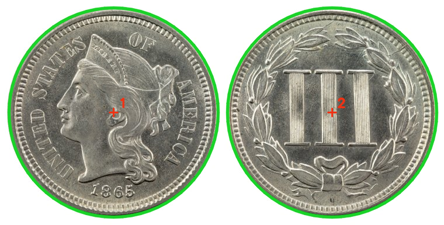
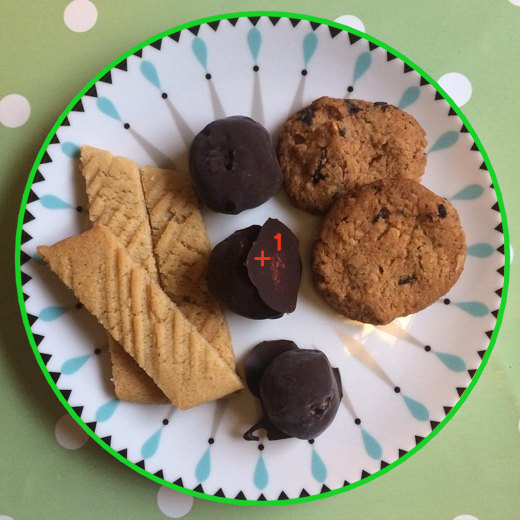

# 霍夫圆检测小工具

视觉组「开发管理」任务三：导入 JPG/JPEG/PNG、调整霍夫参数、对比原图和标注结果、查看圆心与半径、导出完整分辨率 PNG。图形界面运行在本机浏览器，图片由本机 Python 处理，不上传云端。

## 安装与启动

需要 Python 3.10+。在项目根目录运行：

```bash
python3 -m venv .venv
source .venv/bin/activate
python -m pip install -r requirements.txt
python app.py
```

浏览器打开 <http://127.0.0.1:8765>。保持终端运行，按 Ctrl+C 停止。端口占用时可用 `python app.py --port 8766`。Ubuntu 若缺少 venv，可安装系统的 `python3-venv` 包。

1. 点击「硬币样例」或「饼干盘样例」加载照片与对应参数；也可导入自己的图片。
2. 点击「检测圆」，查看两侧原图、标注图与下方圆心半径。
3. 修改参数后重新检测，再点击「导出标注 PNG」。参数改变会使旧结果失效，防止导出与参数不符的图。

图片限制：文件小于 16 MiB、解码后不超过 1200 万像素。参数长度单位均为原始图片像素。预设仅对给定样例验收；其他尺寸和场景需要重新调参。

## 两张实拍图的实际验收

共同参数：`dp=1.0, param1=100, blur=5`。算法为灰度转换 → 中值滤波 → OpenCV `HOUGH_GRADIENT`，绿圈表示外缘，红色十字与编号表示圆心。

| 图片 | 尺寸 | minDist | param2 | minRadius | maxRadius | 实际检测 |
|---|---|---:|---:|---:|---:|---|
| coins.jpg | 760×385 | 250 | 35 | 165 | 190 | 2 个硬币外缘 |
| cookie-plate.jpg | 520×520 | 350 | 30 | 230 | 265 | 1 个盘沿 |

实际结果坐标（x, y, r）：硬币 `(193.5, 192.5, 178.7)`、`(567.5, 191.5, 179.0)`；盘沿 `(262.5, 258.5, 244.9)`。坐标由检测算法产生，未写死到程序。不同 OpenCV 版本可能存在少量像素偏差。

复现命令：

```bash
python app.py --input examples/coins.jpg --output results/coins-annotated.png --preset coins
python app.py --input examples/cookie-plate.jpg --output results/cookie-plate-annotated.png --preset cookie-plate
python -m unittest discover -s tests -v
```

独立虚拟环境已验收 Python 3.12.15 + OpenCV 4.14.0.94 + NumPy 2.5.4；可用 `requirements-lock.txt` 复现该依赖版本。

测试覆盖：两张照片的圆数与外缘位置、导出尺寸和 PNG 编码、零圆结果、无效图片/参数、HTTP 完整检测与错误后的服务可用性。记录见 [OpenSpec 验收](openspec/changes/hough-circle-tool/verification.md)。

### 两个硬币外缘



### 一个盘沿



## 项目结构

- `app.py`：本地服务和命令行入口；只监听 127.0.0.1。
- `detector.py`：参数校验、霍夫检测、标注与预设。
- `web/index.html`：图形界面。
- `examples/`：给定实拍样例与来源许可。
- `results/`：实际验收标注图、JSON 与界面截图。
- `tests/`：检测核心与 HTTP 集成测试。
- `openspec/changes/hough-circle-tool/`：规格、设计、任务与实际验收记录。

## 图片与算法来源

样例取自 [培训练习仓库](https://github.com/Ecrypted-Data/rt-git-openspec-lab/tree/main/examples/hough)。硬币图：Jaclyn Nash / Smithsonian Institution，美国公有领域；饼干盘图：Helen Alfvegren，[CC BY 2.0](https://creativecommons.org/licenses/by/2.0/)。本仓库照片与标注衍生图均沿用相应署名与许可，详见 [SOURCES](examples/SOURCES.md)。

算法参考 [OpenCV 官方霍夫圆检测教程](https://docs.opencv.org/4.x/d4/d70/tutorial_hough_circle.html)。半径范围用于排除内部纹理，param2 越低通常得到更多候选圆；目标接近圆形、外缘清晰时效果更好。

## 技术选型任务五：交接分支

本工作分支：[`feat/video-handoff`](https://github.com/AM1100/hough-circle-tool/tree/feat/video-handoff)。**当前图片功能已完成，视频功能仅有规划，尚未实现。** 本次不新增视频代码。

接手复现：

```bash
git clone --branch feat/video-handoff --single-branch https://github.com/AM1100/hough-circle-tool.git
cd hough-circle-tool
python3 -m venv .venv
source .venv/bin/activate
python -m pip install -r requirements-lock.txt
python -m unittest discover -s tests -v
python app.py --input examples/coins.jpg --output results/coins-annotated.png --preset coins
python app.py --input examples/cookie-plate.jpg --output results/cookie-plate-annotated.png --preset cookie-plate
python app.py
```

所有样例已随Git仓库提交，无需私有下载链接：`examples/coins.jpg`、`examples/cookie-plate.jpg`，来源与许可在 examples/SOURCES.md；`results/` 中保留原尺寸标注图与参数JSON。使用Python 3.12可复现本次实际环境。启动后访问 <http://127.0.0.1:8765>，端口冲突时用 --port 指定其他端口。

2026-11-16重新验收：5项测试通过，硬币2圆、盘沿1圆，圆坐标与上文一致。

- [当前完成状态、实际结果和未验证事项](openspec/changes/add-video-detection/status.md)
- [拟新增视频需求](openspec/changes/add-video-detection/proposal.md)
- [视频验收场景](openspec/changes/add-video-detection/specs/video-circle-detection/spec.md)
- [后续模块方案](openspec/changes/add-video-detection/design.md)
- [接手任务清单](openspec/changes/add-video-detection/tasks.md)

接手人从任务2.1“准备真实短视频并记录元数据”开始。当前 --input 仍接收图片，尚无可运行的视频命令；视频结果、实时性和参数泛化均未验证。后续在同一个 add-video-detection 变更里继续，不要把待办改为已完成。
